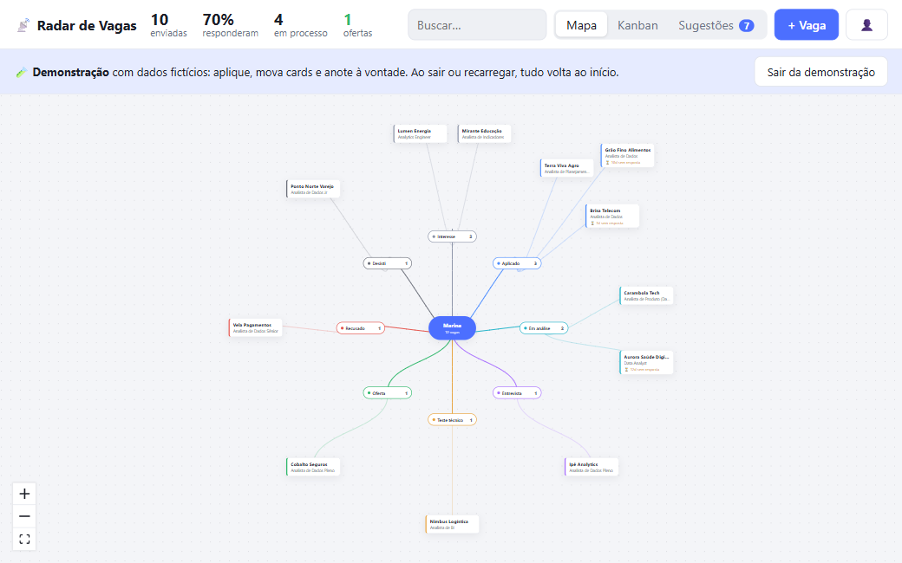
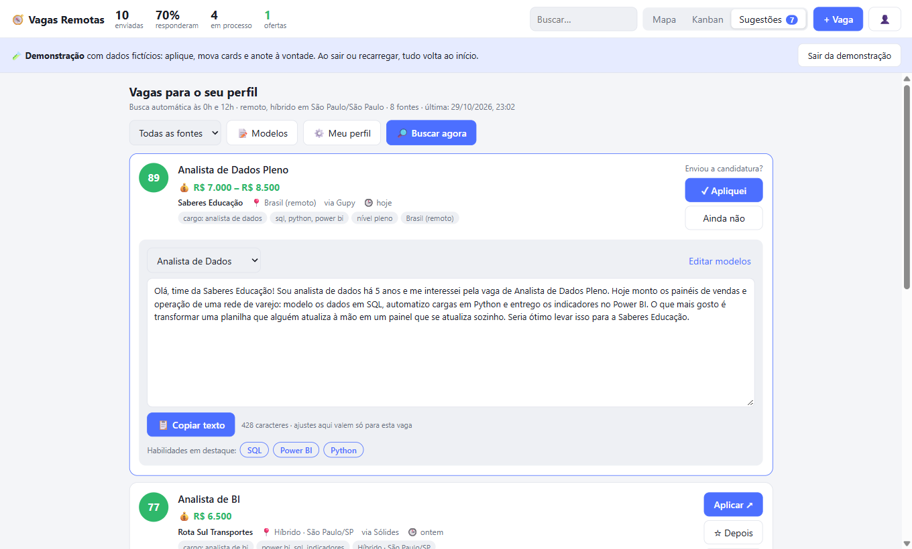
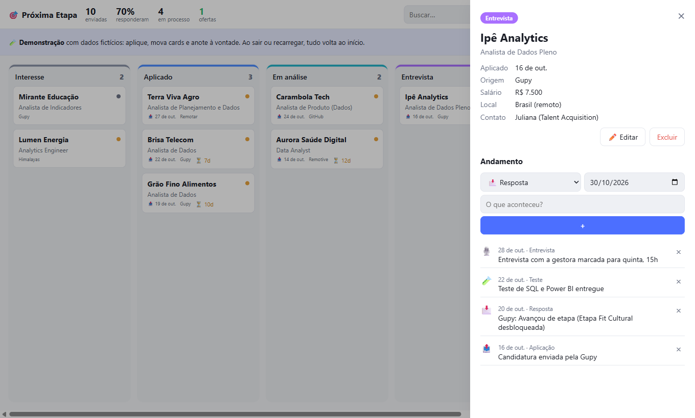
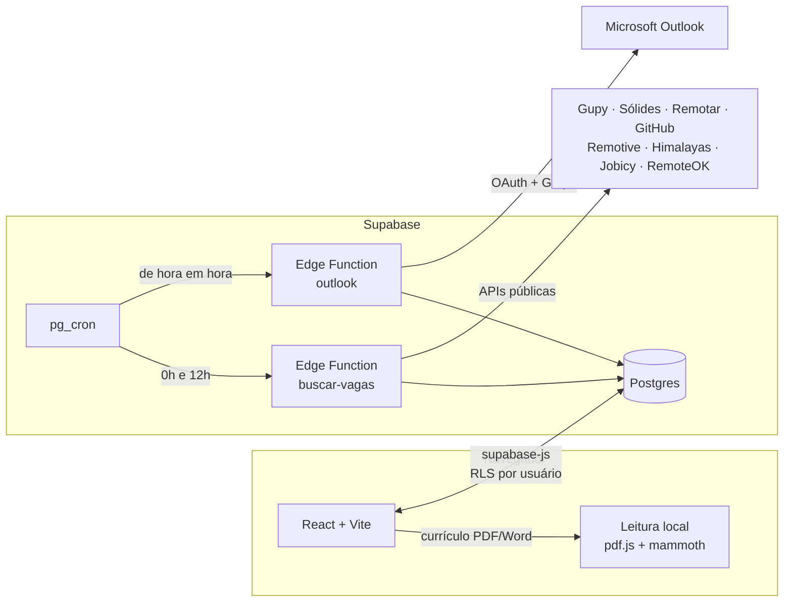

# 📡 Radar de Vagas

**Organizador de busca de emprego.** Reúne vagas de vários portais, dá uma nota para cada uma de acordo com o seu currículo,
acompanha cada candidatura num mapa e num kanban, e lê os e-mails dos processos seletivos para mover as vagas de etapa sozinho.

Nasceu para resolver um problema meu: acompanhar dezenas de candidaturas em portais diferentes, cada uma numa etapa.
Hoje funciona para qualquer área (TI, saúde, comercial, indústria, administrativo…) e aceita outras pessoas por convite.

**[▶ Ver a demonstração](https://radardevagas.vercel.app/?demo)** · **[Case em PDF](docs/case.pdf)**: sem login, com dados fictícios. Dá para aplicar em vagas, mover cards
e anotar à vontade; ao sair ou recarregar a página, tudo volta ao início.



---

## Sumário

- [Funcionalidades](#funcionalidades)
- [Como funciona](#como-funciona)
- [Rodar no seu computador](#rodar-no-seu-computador)
- [Instalação completa](#instalação-completa-sua-própria-cópia)
- [Integração com o Outlook](#integração-com-o-outlook-opcional)
- [Publicar o site](#publicar-o-site)
- [Manual de uso](#manual-de-uso)
- [Administração e convites](#administração-e-convites)
- [Como a nota é calculada](#como-a-nota-é-calculada)
- [Privacidade](#privacidade)
- [Estrutura do projeto](#estrutura-do-projeto)
- [Limitações conhecidas](#limitações-conhecidas)

## Funcionalidades

| | |
|---|---|
| 📄 **Perfil a partir do currículo** | Você envia o PDF ou Word e o app identifica cargos, competências, nível, cidade e inglês. Tudo é lido no navegador, por regras, sem IA, e o arquivo não sai do seu computador. |
| 🔎 **Busca automática de vagas** | Duas vezes por dia, consulta Gupy, Sólides, Remotar, repositórios de vagas do GitHub e, se você tem inglês, Remotive, Himalayas, Jobicy e RemoteOK. |
| 🎯 **Nota de 0 a 100** | Cada vaga recebe uma nota de compatibilidade com o motivo à vista ("cargo: analista de dados", "sql, python"). Vagas repetidas entre portais aparecem uma vez só. |
| 🗺️ **Mapa e kanban** | As candidaturas aparecem em volta de você, agrupadas por etapa, ou num quadro em que dá para arrastar os cards. Vagas sem resposta há 7 dias ou mais ganham o aviso ⏳. |
| 📝 **Kit de candidatura** | Textos "sobre mim" por tipo de vaga, com `%empresa%` e `%cargo%` preenchidos sozinhos, e as habilidades que o formulário pede, prontas para copiar. |
| 📬 **Leitura dos e-mails** | Conectando o Outlook, o app lê os e-mails da Gupy de hora em hora, reconhece entrevista, teste, proposta e recusa, e move a vaga de etapa. |
| 👥 **Multiusuário por convite** | Cada pessoa vê só os próprios dados (Row Level Security no Postgres). O admin convida por e-mail. |

<table>
  <tr>
    <td></td>
    <td></td>
  </tr>
  <tr>
    <td align="center"><sub>Sugestões com nota e kit de texto</sub></td>
    <td align="center"><sub>Andamento de cada candidatura</sub></td>
  </tr>
</table>

## Como funciona



- **Frontend:** Vite, React 19 e TypeScript, sem roteador nem biblioteca de estado. O mapa usa [React Flow](https://reactflow.dev).
- **Backend:** [Supabase](https://supabase.com) (Postgres, Auth, Edge Functions em Deno, pg_cron e pg_net). Cabe no plano gratuito.
- **Hospedagem:** qualquer serviço de site estático (o original está na Vercel).
- **Sem IA no produto:** a leitura do currículo, a nota das vagas e a classificação dos e-mails são regras explícitas, fáceis de auditar e de ajustar.

## Rodar no seu computador

Precisa do [Node.js](https://nodejs.org) 20 ou mais novo.

```bash
git clone https://github.com/eduardoalthaus/radar-de-vagas.git
cd radar-de-vagas
npm install
npm run dev
```

Abra http://localhost:5173. **Sem nenhuma configuração, o app já abre no modo demonstração**: os dados ficam na memória do navegador.
Para usar de verdade, com login e busca automática, siga a instalação completa.

## Instalação completa (sua própria cópia)

### 1. Criar o projeto no Supabase

1. Crie uma conta em [supabase.com](https://supabase.com) e um projeto novo (o plano gratuito basta). Guarde a senha do banco.
2. Em **Project Settings → API**, anote a **Project URL** (`https://<ref>.supabase.co`) e a **publishable key** (`sb_publishable_...`).

### 2. Criar as tabelas

Com a [CLI do Supabase](https://supabase.com/docs/guides/local-development/cli/getting-started):

```bash
npx supabase login
npx supabase link --project-ref <ref>
npx supabase db push
```

Sem a CLI, dá para colar cada arquivo de `supabase/migrations/`, em ordem, no **SQL Editor** do painel.

As migrações criam as tabelas com RLS, ligam `pg_cron` e `pg_net`, geram o segredo do agendamento e agendam as duas funções.

### 3. Informar a URL do projeto ao agendador

O `pg_cron` chama as funções pela URL do projeto. No **SQL Editor**:

```sql
insert into public.config_privada values ('url_projeto', 'https://<ref>.supabase.co')
on conflict (chave) do update set valor = excluded.valor;
```

### 4. Publicar as Edge Functions

```bash
npx supabase functions deploy buscar-vagas
npx supabase functions deploy outlook
```

O `supabase/config.toml` já publica as duas com `verify_jwt = false`, porque elas fazem a própria autenticação: aceitam o login do usuário
ou o header `x-cron-segredo`, cujo valor fica em `config_privada` e nunca vai para o navegador.

Opcional: um token do GitHub (sem nenhuma permissão) aumenta o limite de leitura dos repositórios de vagas:

```bash
npx supabase secrets set GITHUB_TOKEN=<token>
```

### 5. Configurar o login

Em **Authentication → URL Configuration**, coloque o endereço do seu site em **Site URL** (por exemplo, `http://localhost:5173` enquanto testa)
e adicione-o também em **Redirect URLs**. É para onde vai o link de confirmação do cadastro.

### 6. Ligar o site ao projeto

```bash
cp .env.example .env.local
```

Preencha `.env.local` com os valores do passo 1:

```
VITE_SUPABASE_URL=https://<ref>.supabase.co
VITE_SUPABASE_KEY=sb_publishable_...
```

Rode `npm run dev` e crie sua conta. **A primeira conta criada vira a administradora** e pode convidar outras pessoas.

## Integração com o Outlook (opcional)

Para o app ler os e-mails dos processos seletivos, registre um aplicativo na Microsoft (é gratuito):

1. No [portal do Microsoft Entra](https://entra.microsoft.com), vá em **Identidade → Aplicativos → Registros de aplicativo → Novo registro**.
2. Em **Tipos de conta com suporte**, escolha *Contas em qualquer diretório organizacional e contas pessoais da Microsoft*,
   assim funciona com Outlook.com/Hotmail e com contas de empresa.
3. Em **URI de redirecionamento**, escolha *Web* e coloque `https://<ref>.supabase.co/functions/v1/outlook/callback`.
4. Em **Permissões de API → Adicionar → Microsoft Graph → Permissões delegadas**, adicione `Mail.Read`, `User.Read` e `offline_access`.
5. Em **Certificados e segredos → Novo segredo do cliente**, gere um segredo e copie o **valor** na hora (ele não aparece de novo).
6. Guarde os dois valores como secrets das funções:

```bash
npx supabase secrets set MS_CLIENT_ID=<id do aplicativo (cliente)> MS_CLIENT_SECRET=<valor do segredo>
```

Depois disso, o botão **👤 → Conectar Outlook** passa a funcionar. O acesso é só de leitura, e o token fica numa coluna que o navegador não consegue ler.

## Publicar o site

O build é estático (`dist/`) e roda em qualquer hospedagem. Na [Vercel](https://vercel.com):

```bash
npm run build            # confere os tipos e gera dist/
npx vercel --prod
```

Na primeira vez, cadastre `VITE_SUPABASE_URL` e `VITE_SUPABASE_KEY` em **Settings → Environment Variables** do projeto na Vercel
(ou importe o repositório pelo painel, que já detecta o Vite). Netlify, Cloudflare Pages e GitHub Pages funcionam do mesmo jeito.
Lembre de colocar o endereço publicado em **Site URL** e **Redirect URLs** no Supabase.

## Manual de uso

### Primeiro acesso

1. **Envie o currículo** (PDF com texto ou Word). O app preenche nome, nível, cargos, competências e local. PDF escaneado (imagem) não tem texto para ler, então preencha à mão.
2. **Confira o filtro.** Escolha onde quer trabalhar (remoto, híbrido, presencial) e, para híbrido ou presencial, a cidade ou o estado.
3. **Salvar e buscar vagas** faz a primeira busca na hora. Depois ela roda sozinha às 0h e às 12h (horário de Brasília).

### Sugestões

- **Aplicar ↗** abre a vaga no portal e mostra o kit de texto. Depois de enviar, clique em **✓ Apliquei**: a vaga entra no mapa como *Aplicado*.
- **☆ Depois** guarda a vaga como *Interesse*; **Descartar** some com ela. Vagas aplicadas ou descartadas não voltam nas próximas buscas.
- **🔎 Buscar agora** busca na hora (no máximo uma vez por minuto).
- Poucas sugestões? Em **⚙️ Meu perfil**, inclua mais cargos ou baixe a nota mínima em *Ajustes avançados*.

### Modelos de apresentação

Em **📝 Modelos**, escreva um texto "sobre mim" para cada tipo de vaga e defina as palavras do título que o ativam.
O app escolhe o modelo que mais combina com a vaga; `%empresa%` e `%cargo%` são trocados pelo nome da empresa e pelo título.

### Mapa, kanban e andamento

- **+ Vaga** registra candidaturas feitas fora do app (LinkedIn, indicação…).
- No **Kanban**, arraste o card para mudar de etapa. A mudança fica registrada no andamento da vaga.
- Clique numa vaga para ver os detalhes e anotar retornos, entrevistas, testes e follow-ups com data.
- As etapas são *Interesse → Aplicado → Em análise → Entrevista → Teste técnico → Oferta / Recusado / Desisti*.

### E-mails

Em **👤 → Conectar Outlook**, autorize a leitura. A cada hora o app lê os e-mails novos da Gupy, associa cada um à vaga
(pelo link, pelo nome da empresa e pelo cargo) e move a etapa: entrevista, teste, proposta ou recusa.
E-mails que ele não conseguiu associar aparecem com um seletor para você indicar a vaga.

## Administração e convites

O cadastro é fechado: só cria conta quem foi convidado. As regras ficam na tabela `config_privada`,
que não tem política de acesso (só o banco e as funções leem):

| chave | para que serve |
|---|---|
| `admin_email` | Quem pode convidar. Preenchida sozinha com a primeira conta criada. |
| `cadastro_aberto` | `sim` libera o cadastro para qualquer e-mail. |
| `url_projeto` | URL do projeto, usada pelo agendador. |
| `cron_segredo` | Gerado na instalação; autentica o agendador nas funções. |

O admin convida em **👤 → Convites**. Para trocar o admin:

```sql
update public.config_privada set valor = 'novo@email.com' where chave = 'admin_email';
```

## Como a nota é calculada

| Critério | Pontos |
|---|---|
| Cargo de interesse no título | +45 (só na descrição: +5) |
| Cada competência encontrada | +4, até 30 |
| Nível compatível (júnior, pleno, sênior) | +10 |
| Vaga de liderança para quem não é sênior | −15 |
| Vaga no Brasil · internacional que aceita Brasil/LATAM | +10 · +5 |

Ficam de fora as vagas com termos excluídos no título (estágio, trainee…), as publicadas há mais de 30 dias,
as internacionais restritas a outros países e as que não chegam à nota mínima (padrão 50).

## Privacidade

- O currículo é lido **no navegador** e não é enviado nem guardado. Fica salvo só o perfil de busca que você confere.
- Cada pessoa só enxerga as próprias vagas, sugestões e e-mails (RLS em todas as tabelas).
- O acesso ao Outlook é só de leitura, e o token não é legível pelo navegador.
- **👤 → Excluir minha conta e dados** apaga tudo em cascata.

## Estrutura do projeto

```
src/
  App.tsx              telas e estado principal
  lib.ts               cliente do Supabase, tipos e utilidades
  demonstracao.ts      modo demonstração (imita o Supabase em memória)
  demonstracao-dados.ts  dados fictícios da demonstração
  curriculo.ts         leitura do currículo e montagem do perfil
  dicionario.ts        cargos e competências reconhecidos (edite para incluir os seus)
  MindMap.tsx  Kanban.tsx  Sugestoes.tsx  VagaPanel.tsx  Kit.tsx  Modelos.tsx
  PerfilEditor.tsx  Conta.tsx  EmailsGupy.tsx  Login.tsx
supabase/
  migrations/          schema completo, em ordem
  functions/
    buscar-vagas/      busca nos portais e pontuação
    outlook/           OAuth com a Microsoft e leitura dos e-mails
docs/                  imagens deste README
```

### Comandos

```bash
npm run dev       # servidor local
npm run build     # confere os tipos e gera o build
npx eslint src    # lint
```

## Limitações conhecidas

- **Portais sem API oficial para candidatos.** Gupy e Sólides são lidas pela mesma busca pública que os sites usam, que pode mudar sem aviso.
  Remotive, Jobicy e RemoteOK pedem crédito com link para a vaga original, que o app mostra ("via …").
- **Não existe candidatura automática.** Gupy, LinkedIn e os ATS (Greenhouse, Lever…) não oferecem isso, então o app abre a vaga e prepara o texto, e quem envia é você.
- **E-mails:** por enquanto só Outlook e só e-mails da Gupy, porque as regras foram montadas a partir de assuntos reais. Gmail e outros portais seriam o próximo passo.
- **Plano gratuito do Supabase:** o projeto é pausado após 7 dias sem acesso; é só reativar no painel.
